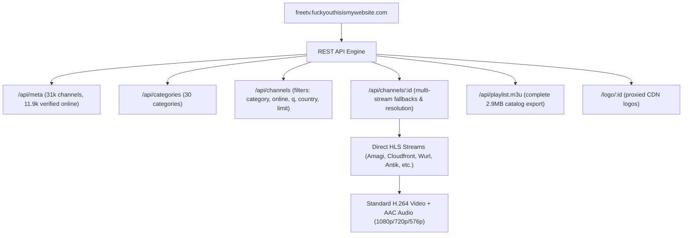
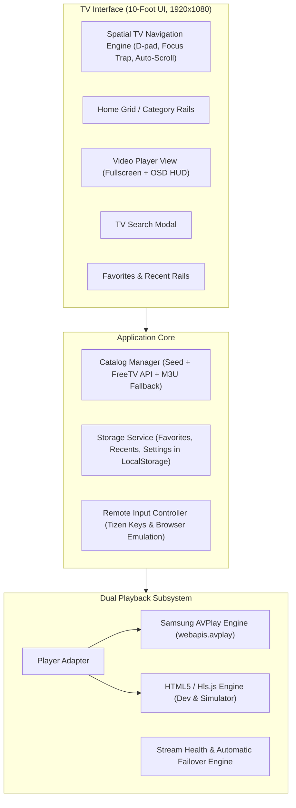

# Implementation Plan: TV_Abdul (Samsung Smart TV Native Application)

## Goal Description
Build **TV_Abdul**, a fully functional, high-performance native Samsung Smart TV Web Application (`.wgt`) running on **Tizen OS**. The application allows users to discover, search, organize, and watch thousands of live television channels sourced from `https://freetv.fuckyouthisismywebsite.com/` and legitimate public IPTV streams. 

The application is engineered specifically for TV hardware:
- Fully remote-controlled navigation (Samsung D-Pad, Enter, Return/Back, Channel Up/Down, Media keys).
- Dual playback engine: Native **Samsung AVPlay (`webapis.avplay`)** hardware-accelerated pipeline for Samsung Smart TVs, with seamless **HTML5 / Hls.js fallback** for PC/browser/simulator environments.
- Self-contained and robust: Features a bundled offline seed catalog, dynamic live synchronization from the FreeTV API, multi-stream automatic failover, and local persistence for favorites, history, and last-watched channel.
- Complete Windows-compatible installation guide and automated `.wgt` packaging for Samsung TV Developer Mode sideloading.

---

## User Review Required

> [!IMPORTANT]
> **Streaming Technology & Architecture Decisions:**
> 1. **Dual Video Player Engine**: On physical Samsung TVs, the application uses Samsung's low-level hardware player (`webapis.avplay`), which bypasses browser sandbox limitations and handles high-bitrate HLS/DASH streams smoothly. In development or non-Tizen environments, it automatically switches to HTML5 `<video>` + Hls.js.
> 2. **Catalog Resilience (Hybrid Online + Offline)**: To ensure immediate launch without network stalling, the application bundles a curated offline seed catalog of ~100 top verified channels across major categories (News, Sports, Entertainment, Movies, Documentaries, Kids) while providing seamless dynamic search and on-demand pagination from `https://freetv.fuckyouthisismywebsite.com/api`.
> 3. **Packaging & Sideloading**: Samsung TVs require a `.wgt` package signed with Samsung developer certificates or installed via Tizen Studio CLI / SDB in Developer Mode. We will provide an automated packaging script to build the `.wgt` bundle, alongside comprehensive Windows step-by-step instructions in `INSTALLATION.md`.

---

## Source Website Investigation Summary

Our deep inspection of `https://freetv.fuckyouthisismywebsite.com/` revealed the following key findings (to be fully documented in `SOURCE_ANALYSIS.md`):

- **Catalog Backend**: The site runs a performant backend querying iptv-org data, actively health-checking streams every few minutes (`online: 11,941` working streams out of 16,519 probed).
- **Direct Streams**: Stream URLs are standard HLS (`.m3u8`) and DASH (`.mpd`) hosted on global content delivery networks (Amagi, AWS Cloudfront, Wurl, Ichibansys, Antik, etc.).
- **Codecs Verified**: `ffprobe` analysis verified that streams use standard **H.264 video** and **AAC audio** (1080p, 720p), fully compatible with Samsung Tizen hardware decoders.
- **Access & Headers**: Most streams provide open CORS headers (`Access-Control-Allow-Origin: *`). For streams with custom headers or HTTP-only protocols, Samsung AVPlay executes directly in the Tizen native media stack, bypassing browser mixed-content restrictions.

---

## Proposed Architecture

### Technology Stack
- **Framework**: React 18 + Vite (Clean, modular, component-driven, zero unnecessary external bloated dependencies).
- **Styling**: Tailored TV CSS with custom CSS variables, high-contrast dark theme, TV-safe margins (overscan protection), visible glowing focus rings, and hardware-accelerated animations (`transform: translate3d`).
- **Platform**: Samsung Tizen Web Application API (`tizen.tvinputdevice`, `webapis.avplay`, `tizen.application`).
- **Packaging**: Tizen `config.xml` specification + automated node packaging script producing `TV_Abdul.wgt`.

---

## Proposed Changes

### 1. Project Configuration & Tizen Manifest

#### [NEW] `package.json`
- Project metadata: `TV_Abdul`, version 1.0.0.
- Dependencies: `react`, `react-dom`, `lucide-react` (for TV icons), `hls.js` (for fallback player).
- DevDependencies: `@vitejs/plugin-react`, `vite`, `archiver` (for creating `.wgt` ZIP package), `vitest` (for automated unit testing).
- Scripts: `dev`, `build`, `package`, `test`.

#### [NEW] `vite.config.js`
- Configure Vite for TV web application output: relative asset paths (`base: './'`), target `es2020` or `chrome69` (for compatibility with Tizen 4.0+), inline CSS assets if desired, clean bundle output.

#### [NEW] `config.xml`
- Official Samsung Tizen application manifest:
  - App ID: `Abdul00101.TV_Abdul`
  - Name: `TV_Abdul`
  - Version: `1.0.0`
  - Categories: `http://tizen.org/category/tv`
  - Privileges:
    - `http://tizen.org/privilege/internet`
    - `http://tizen.org/privilege/tv.inputdevice`
    - `http://tizen.org/privilege/application.launch`
  - Access control: `<access origin="*" subdomains="true"/>`
  - Tizen TV metadata: `<tizen:metadata key="http://samsung.com/tv/metadata/use.avplay" value="true"/>`
  - Screen resolution: `1920x1080`

#### [NEW] `public/icon.png`
- High-resolution TV application launcher icon with "TV Abdul" branding and live TV icon.

---

### 2. TV Navigation & Input Management

#### [NEW] `src/services/remoteKeyManager.js`
- Register Samsung TV remote keys using `tizen.tvinputdevice.registerKeyBatch()` or `registerKey()`:
  - `MediaPlay`, `MediaPause`, `MediaPlayPause`, `MediaStop`, `MediaFastForward`, `MediaRewind`
  - `ChannelUp`, `ChannelDown`
  - `0`, `1`, `2`, `3`, `4`, `5`, `6`, `7`, `8`, `9`
- Key normalizer: maps both Samsung Tizen keycodes (`10009` for Back, `427` for ChUp, `428` for ChDown) and standard keyboard keys (Escape, Backspace, Arrow keys, PageUp, PageDown) into unified TV actions.

#### [NEW] `src/services/spatialNav.js` / `src/hooks/useSpatialNav.js`
- 2D grid/list spatial navigation algorithm:
  - Calculates Euclidean distance and directional overlap between focusable elements (`[data-nav-id]`).
  - Smooth automatic scrolling to keep focused cards in center view.
  - Focus trap support for modals (search, settings, error overlays).
  - Memory of last focused element when returning from player to grid.

---

### 3. Streaming Engine & AVPlay Integration

#### [NEW] `src/services/player/PlayerInterface.js`
- Base playback interface definition:
  - `open(streamUrl, options)`
  - `play()`, `pause()`, `stop()`, `destroy()`
  - `setDisplayRect(x, y, width, height)`
  - `getDuration()`, `getCurrentTime()`, `getState()`
  - Event listeners: `onBufferingStart`, `onBufferingComplete`, `onStreamCompleted`, `onError`

#### [NEW] `src/services/player/SamsungAVPlayer.js`
- Hardware-accelerated Samsung TV playback using `window.webapis.avplay`:
  - `webapis.avplay.open(url)`
  - `webapis.avplay.setDisplayRect(0, 0, 1920, 1080)`
  - `webapis.avplay.setDisplayMethod('PLAYER_DISPLAY_MODE_AUTO_ASPECT_RATIO')`
  - `webapis.avplay.prepareAsync(onSuccess, onError)`
  - `webapis.avplay.play()`
  - Lifecycle state machine: `IDLE`, `READY`, `PLAYING`, `PAUSED`, `BUFFERING`, `ERROR`
  - Safe teardown: `avplay.stop()`, `avplay.close()` with try/catch to avoid native resource leaks.
  - Custom HTTP header support (`setStreamingProperty("USER_AGENT", ...)`).

#### [NEW] `src/services/player/Html5Player.js`
- HTML5 `<video>` + `Hls.js` player implementation:
  - Used in desktop browsers, simulators, and environments where `webapis.avplay` is unavailable.
  - Automatically loads and attaches `hls.js` for m3u8 streams with full error recovery.

#### [NEW] `src/services/player/PlayerFactory.js`
- Detects runtime (`Boolean(window.webapis && window.webapis.avplay)`):
  - Returns `SamsungAVPlayer` on real Samsung TVs.
  - Returns `Html5Player` on PC / dev environments.
  - Manages stream failover (tries primary stream, if error occurs tries fallback streams from channel's `streams` array).

---

### 4. Channel Catalog & Storage Services

#### [NEW] `src/services/storageService.js`
- Local storage wrapper with TV resilience:
  - Favorites list (`freetv:favorites`)
  - Recently watched channels (`freetv:recent`, max 30)
  - Last watched channel ID (`freetv:last_channel`)
  - User settings (preferred stream quality, catalog source).

#### [NEW] `src/services/catalogService.js`
- Channel catalog management:
  - Bundled offline seed database: ~100 top verified global & regional channels (News: Sky News, Al Jazeera, Bloomberg, France 24, Euronews, DW; Sports: Red Bull TV, ACC Digital, ACI Sport; Entertainment & Movies; Kids; Documentaries).
  - Live API integration with `https://freetv.fuckyouthisismywebsite.com/api`:
    - `fetchCategories()`
    - `fetchChannels({ category, q, country, page, limit, online: true })`
    - `fetchChannelDetails(channelId)`
  - Multi-stream fallback: if a stream fails during playback, `catalogService` provides verified alternative stream URLs for that channel.
  - M3U parser utility for custom user playlists or offline M3U files.

---

### 5. User Interface Components

#### [NEW] `src/components/Header.jsx`
- App logo: "TV Abdul" with live badge.
- Current active category indicator.
- Search button & Favorites shortcut.
- Digital clock displaying live local time.

#### [NEW] `src/components/CategoryBar.jsx`
- Horizontal scrolling navigation bar of categories:
  - "All", "Favorites", "Recent", "News", "Sports", "Movies", "Entertainment", "Documentary", "Kids", "Music".
- Focusable with Left/Right, auto-scrolls, Select/Enter filters the channel view.

#### [NEW] `src/components/ChannelGrid.jsx`
- High-performance TV grid of channels:
  - Channel cards displaying logo with graceful fallback icon, channel number, name, country flag/code, resolution badge (1080p, 720p).
  - Selected / focused card enlarges smoothly (`scale(1.05)`) with an accented glowing border.
  - Pressing Enter launches instant playback.

#### [NEW] `src/components/VideoPlayerView.jsx`
- Fullscreen video playback interface:
  - Underlying video plane (transparent for AVPlay hole-punching, or `<video>` element for HTML5).
  - **On-Screen Display (OSD)**:
    - Channel number, name, country, quality badge.
    - Category name, live stream indicator.
    - OSD automatically fades out after 5 seconds of inactivity.
    - Pressing any D-pad arrow or Enter re-displays the OSD.
  - **Remote channel zapping**:
    - Channel Up / Up Arrow: switches to next channel.
    - Channel Down / Down Arrow: switches to previous channel.
    - Number keys: direct channel number entry.
  - **Loading & Error HUD**:
    - Animated buffering spinner.
    - Error overlay with automatic stream failover countdown ("Stream 1 failed, trying stream 2..."), retry button, and "Return to Grid" button.

#### [NEW] `src/components/SearchModal.jsx`
- On-screen TV search interface:
  - Virtual TV keypad or standard input field.
  - Instant live search results as user types.
  - Return / Back key dismisses modal.

#### [NEW] `src/components/SettingsModal.jsx`
- Shows app version, connection status to FreeTV API, cache stats, option to reload catalog or reset favorites.

#### [NEW] `src/App.jsx` & `src/main.jsx`
- Application root orchestrator:
  - Initializes RemoteKeyManager and SpatialNav.
  - Manages view transitions (`home`, `player`, `search`, `settings`).
  - Handles the Samsung Tizen hardware Back button (`10009`):
    - When player is active: exits player and returns to channel grid.
    - When modal is active: closes modal.
    - When in category or search: returns to top of Home.
    - When at root Home: prompts exit / calls `tizen.application.getCurrentApplication().exit()`.

---

### 6. Packaging & Deployment Scripts

#### [NEW] `scripts/package-wgt.js`
- Node.js script that:
  - Builds the production distribution (`npm run build`).
  - Packages the output directory alongside `config.xml` and `icon.png` into `dist/TV_Abdul.wgt`.
  - Verifies the ZIP structure matches Samsung Tizen requirements.

---

### 7. Documentation Deliverables

#### [NEW] `SOURCE_ANALYSIS.md`
- Detailed technical report of `https://freetv.fuckyouthisismywebsite.com/`:
  - Network endpoints, data models, stream extraction methods.
  - Codec analysis (H.264/AAC), CORS status, CDN origins.
  - Comparison between direct HLS streaming and AVPlay native handling.

#### [NEW] `INSTALLATION.md`
- Exhaustive step-by-step sideloading guide for Windows users:
  1. Setting up Samsung Smart TV Developer Mode (via TV Apps menu code `12345`).
  2. Installing Tizen Studio & TV Extension (or using standalone SDB command-line tools).
  3. Generating a Samsung Certificate profile.
  4. Connecting PC to TV via Device Manager / SDB (`sdb connect <TV_IP>`).
  5. Building and packaging `TV_Abdul.wgt`.
  6. Installing the `.wgt` on the TV (`sdb install TV_Abdul.wgt` or Tizen Studio Run As > Tizen Web Application).
  7. Verification, remote control testing, and troubleshooting common connection/certificate errors.

#### [NEW] `README.md`
- Project overview, features, remote key mapping guide, development instructions.

#### [NEW] `TEST_RESULTS.md`
- Automated test runs, codec probe outputs, remote navigation validation, and player lifecycle tests.

---

## Verification Plan

### Automated Tests
1. **Catalog & Stream Unit Tests**:
   - Run Vitest tests verifying:
     - Catalog parsing, filtering by category, search query indexing.
     - Multi-stream fallback logic on simulated network failure.
     - LocalStorage persistence for favorites and recents.
   - Command: `npm test`
2. **Production Build & Packaging Verification**:
   - Run Vite production build: `npm run build`
   - Run package script: `npm run package`
   - Verify `TV_Abdul.wgt` exists, verify internal ZIP structure (contains `config.xml`, `index.html`, `icon.png`, assets).
   - Command: `node scripts/package-wgt.js && unzip -l dist/TV_Abdul.wgt`
3. **Live Stream Codec Validation**:
   - Test verified channels using `ffprobe` to ensure active H.264 video and AAC audio delivery.

### Manual Verification
1. **Development Browser / Simulator Verification**:
   - Start local dev server (`npm run dev`).
   - Open app in browser; verify D-Pad navigation using keyboard arrows, Enter, Backspace/Escape.
   - Test category switching (News, Sports, Movies, etc.).
   - Launch video player on a live channel (e.g. Al Jazeera, Bloomberg, Sky News, MaisUm) and verify video and audio playback.
   - Verify OSD overlay auto-hide (5s timeout) and channel switching (Up/Down / CH+/CH-).
   - Test search view and favorites toggling.
2. **Samsung Smart TV Hardware Verification**:
   - Follow `INSTALLATION.md` to deploy `TV_Abdul.wgt` onto a Samsung Smart TV running Tizen OS.
   - Confirm remote control buttons respond (D-pad, Return, Enter, Ch+/Ch-).
   - Confirm Samsung AVPlay renders video full-screen in native 1080p.
