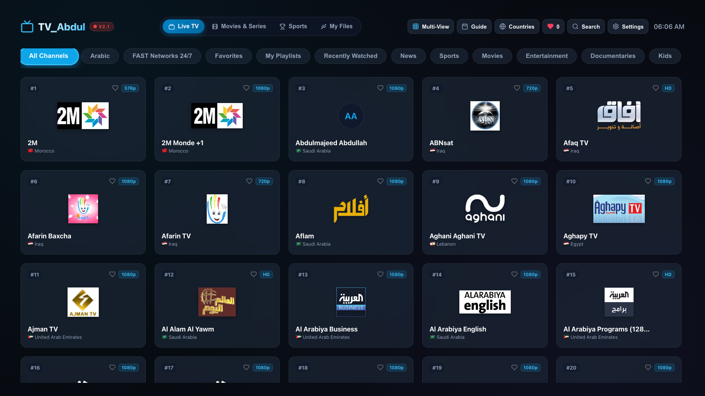
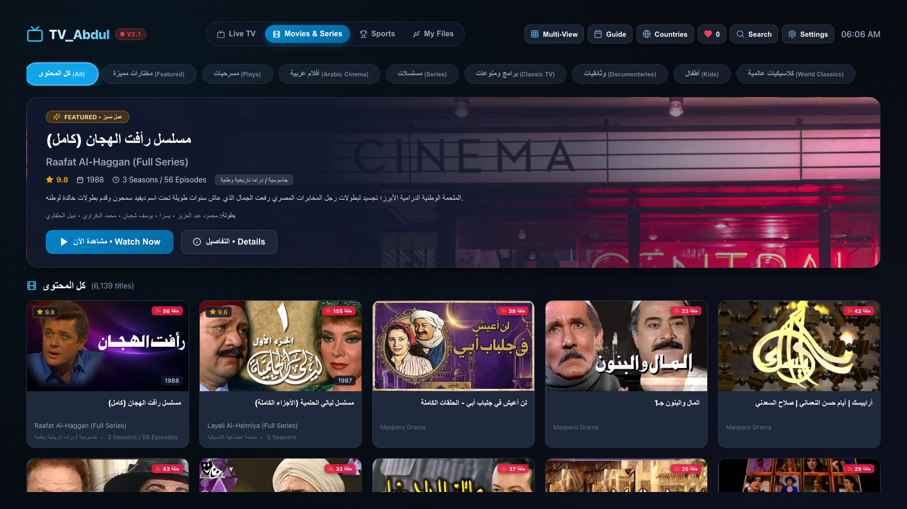
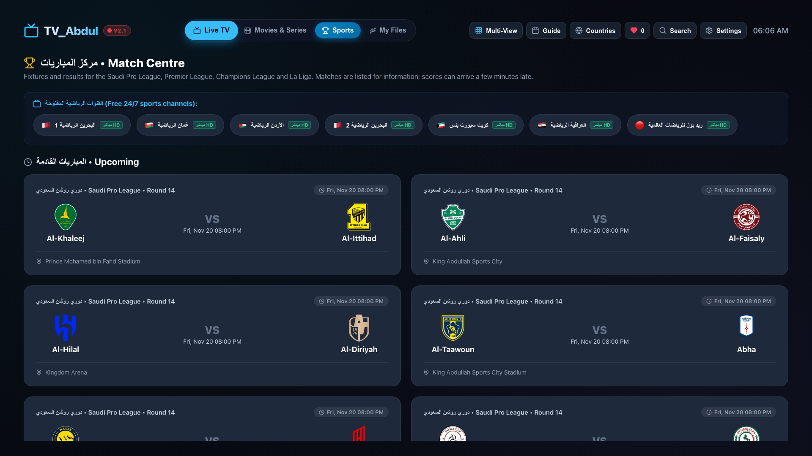
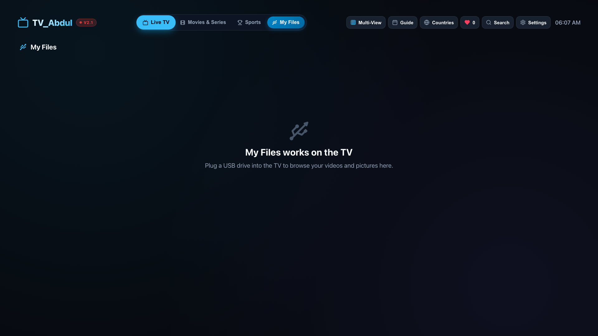

# TV_Abdul: Native Samsung Smart TV Live Streaming Application

**TV_Abdul** is a dedicated, remote-controlled native Samsung Smart TV application running on **Tizen OS**. It provides an elegant 10-foot television interface for discovering and watching thousands of free, publicly available live TV channels from around the world.

---

## Screenshots

Captured from the v2.1 build at the TV's 1920x1080 resolution.

| Live TV | Movies & Series |
| :---: | :---: |
|  |  |
| **Match Centre** | **My Files** |
|  |  |

My Files is shown as it appears in a desktop browser; on the TV it lists the connected USB drive.

---

## Key Features

- **Native Samsung AVPlay Engine (`webapis.avplay`):** Direct hardware-accelerated HLS/DASH playback for Samsung Smart TVs, with seamless fallback to HTML5 `<video>` + `Hls.js` in development and browser environments.
- **Full TV Remote Control Navigation:** Custom spatial navigation engine optimized for Samsung D-Pad (Up, Down, Left, Right), Enter, Hardware Back (`keyCode 10009`), Channel Up/Down (`427`, `428`), and Media playback keys.
- **Hybrid Catalog Engine:** Includes a pre-bundled seed database of 132 verified online channels across 9 major categories for instant cold boot with zero network latency, plus live synchronization and search via the FreeTV API.
- **Automatic Stream Failover:** Multi-stream redundancy with automatic detection of broken feeds and seamless failover to backup sources without crashing the player.
- **10-Foot Television User Interface:** Dark-themed UI inspired by Samsung TV Plus and Apple TV, with overscan protection, active glowing focus rings, channel logo fallbacks, and an auto-hiding On-Screen Display (OSD).
- **Persistent Local Storage:** Retains favorite channels, recently watched history, and last-viewed channel across TV reboots.
- **Sideload Packaging:** Bundles directly into a standalone, installable `.wgt` (Tizen Web Widget) package ready for Samsung TV Developer Mode.

---

## Samsung TV Remote Control Mapping

| Remote Button | Key Code | Action in Application |
| :--- | :--- | :--- |
| **D-Pad Up / Down / Left / Right** | `38, 40, 37, 39` | Directional spatial navigation between cards and tabs |
| **Enter / OK / Select** | `13` | Launch selected channel or toggle OSD |
| **Return / Back** | `10009` *(or `27`, `8`)* | Return from video player to guide; close dialogs; exit app |
| **Channel Up / Channel Down** | `427, 428` *(or `33, 34`)* | Instant channel zapping during playback |
| **Media Play / Pause** | `415, 19, 10252, 179` | Toggle video stream play and pause |
| **Left / Right (in Player)** | `37, 39` | Cycle between alternative stream feeds for the channel |
| **Search Button** | `Search` | Open TV search modal with instant query filtering |

---

## Project Structure

```text
TV_Abdul/
├── config.xml                  # Official Samsung Tizen Application Manifest
├── icon.png                    # 512x512 Samsung TV application icon
├── package.json                # Project dependencies and build scripts
├── vite.config.js              # TV-optimized Vite configuration (base: './')
├── index.html                  # Application entry point with Tizen WebAPIs
├── TV_Abdul.wgt                # Ready-to-install Samsung Tizen package
├── SOURCE_ANALYSIS.md          # Technical research of FreeTV API & stream codecs
├── INSTALLATION.md             # Complete Windows sideloading guide for Samsung TV
├── TEST_RESULTS.md             # Verification logs & codec inspection reports
├── scripts/
│   └── package-wgt.js          # Automated Tizen .wgt archiver script
├── src/
│   ├── main.jsx                # Application mounting entry point
│   ├── App.jsx                 # View state coordinator & hardware key router
│   ├── index.css               # 10-foot TV styles & focus indicators
│   ├── data/
│   │   ├── seedChannels.json   # 132 curated, verified online channels with streams
│   │   └── categories.json     # 29 categories from source catalog
│   ├── components/
│   │   ├── Header.jsx          # TV top bar, clock, favorites counter
│   │   ├── CategoryBar.jsx     # Focusable category navigation pills
│   │   ├── ChannelCard.jsx     # Focusable channel card with logo & badges
│   │   ├── ChannelGrid.jsx     # 5-column responsive TV grid
│   │   ├── VideoPlayerView.jsx # Fullscreen video view with OSD & channel zapping
│   │   ├── SearchModal.jsx     # Remote-friendly TV search modal
│   │   └── SettingsModal.jsx   # System info, playback engine & cache controls
│   └── services/
│       ├── remoteKeyManager.js # Samsung Tizen key registration & normalization
│       ├── spatialNav.js       # 2D Euclidean spatial navigation engine
│       ├── storageService.js   # LocalStorage favorites and history persistence
│       ├── catalogService.js   # Channel discovery & multi-stream resolver
│       └── player/
│           ├── PlayerInterface.js   # Abstract player contract & state machine
│           ├── SamsungAVPlayer.js   # Hardware AVPlay (webapis.avplay) engine
│           ├── Html5Player.js       # HTML5 + Hls.js fallback engine
│           └── PlayerFactory.js     # Engine selector & automatic failover
└── tests/
    ├── catalogService.test.js  # Catalog filtering and search unit tests
    ├── remoteKeyManager.test.js# Tizen keycode normalization unit tests
    └── storageService.test.js  # Persistence unit tests
```

---

## Development & Build Commands

```bash
# 1. Install dependencies
npm install

# 2. Run automated test suite
npm test

# 3. Start local development server (with HTML5/Hls.js preview)
npm run dev

# 4. Compile production distribution
npm run build

# 5. Build Samsung Tizen package (TV_Abdul.wgt)
npm run package
```

---

## Installation on Samsung Smart TV

For complete step-by-step instructions on enabling Developer Mode, connecting via SDB / Tizen Studio, creating Samsung certificates, and sideloading `TV_Abdul.wgt` from a Windows PC, refer to:

👉 **[INSTALLATION.md](file:///Users/abdullahalshehri/Desktop/TV_Abdul/INSTALLATION.md)**
